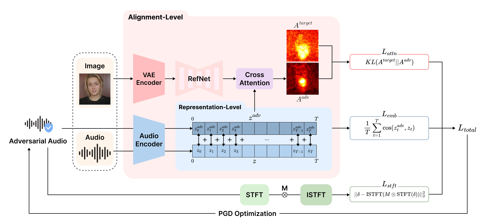

# MUTE: Multi-Level Alignment Uncoupling Against Talking-Head Exploitation for Voice Protection

Official PyTorch implementation of **MUTE**, accepted to **NeurIPS 2026**.

**Donghyun Kim\*, Jin Hong\*, Seungmin Kim\*, Dain Kim, Junseok Kwon, Daeseon Choi**
<br>\* Equal contribution

<p>
  <a href="https://jindl465.github.io/website/projects/MUTE/"></a>
  <a href="https://jindl465.github.io/website/projects/MUTE/#demos"></a>
  <a href="https://jindl465.github.io/website/projects/MUTE/assets/paper.pdf"></a>
  
</p>

🎬 **Project page:** https://jindl465.github.io/website/projects/MUTE/
<br>Side-by-side video comparisons with the baselines, black-box transfer, robustness to purification, combination with image protection, and an interactive version of the user study.

## Overview

<p align="center">
  
</p>

MUTE protects speech from being exploited by audio-driven talking-head
generators. It adds a small, L∞-bounded perturbation to the waveform so that a
talking-head model driven by the protected audio no longer produces lip motion
that follows the speech, while the audio itself stays close to the original.
The perturbation is optimized with a two-phase PGD procedure against a frozen,
pretrained [Hallo](https://github.com/fudan-generative-vision/hallo) model, so
no training is involved.

## Repository Structure

```text
MUTE/
  assets/                      # figures used in this README
  protect/
    protect_audio_multi.py     # main entry point: protects every speaker folder in a dataset
    protect_audio.py           # two-phase PGD optimization, L_stft, hyperparameters
    audio_loss.py              # L_emb, L_attn, and the attention hooks
    visualize_lip_attn.py      # attention capture used to build the target distribution
    protect_hallo.py           # minimal Hallo runtime wrapper
    configs/attack/base.yaml   # config for the single-speaker entry point
  hallo/                       # Hallo model code, portrait preprocessing, runtime config
  eval/
    evaluate_fid.py            # FID, FVD, E-FID
    evaluate_mlmd.py           # M-LMD (mouth landmark distance)
    syncnet/                   # SyncNet audio-visual synchronization
  example_data/0002/           # one portrait and one WAV for a quick end-to-end run
  pretrained_models/           # place the pretrained checkpoints here (not tracked)
  requirements.txt
```

## Installation

The code requires Python 3.10 or later and an NVIDIA GPU. `requirements.txt`
pins PyTorch 2.2.2 built for CUDA 12.1.

```bash
git clone https://github.com/jindl465/MUTE.git
cd MUTE

conda create -n mute python=3.10
conda activate mute
pip install -r requirements.txt
```

The SyncNet and M-LMD evaluation scripts call the `ffmpeg` executable. Install
it with your system package manager if it is not already available, for example
`sudo apt-get install ffmpeg`.

## Pretrained Models

MUTE runs against the pretrained Hallo model and the components it depends on.
All of them are distributed in the official Hallo model repository,
[`fudan-generative-ai/hallo`](https://huggingface.co/fudan-generative-ai/hallo).
Download them into `pretrained_models/` from the repository root:

```bash
huggingface-cli download fudan-generative-ai/hallo \
  --local-dir pretrained_models \
  --exclude README.md .gitattributes
```

The protection code reads the following files:

```text
pretrained_models/
  stable-diffusion-v1-5/
  sd-vae-ft-mse/
  face_analysis/
    models/
      face_landmarker_v2_with_blendshapes.task
  motion_module/
    mm_sd_v15_v2.ckpt
  hallo/
    net.pth
  wav2vec/
    wav2vec2-base-960h/
```

These paths match the defaults in `hallo/configs/train/stage2.yaml`. If your
checkpoints live elsewhere, symlink them into `pretrained_models/` or edit that
file. The checkpoints are subject to the licenses of their original sources.

## Data Preparation

Prepare one folder per speaker, each with one portrait and one or more speech
clips:

```text
dataset/
  speaker_id/
    portrait.png
    audio.wav
    ...
```

- The portrait can be `.png`, `.jpg`, or `.jpeg`. If a folder contains several
  images, the first one in alphabetical order is used.
- Every `.wav` file in the folder is protected. Audio is loaded at 16 kHz; mono
  WAV files are recommended.
- The target attention distribution is computed once per speaker, from the
  first WAV file, and reused for the remaining files of that speaker.

The paper reports results on TalkingHead-1KH and CelebV-HQ. The datasets are not
redistributed here; please obtain them from their original sources.

## Quick Start

`example_data/0002` contains one portrait and one WAV file. Once the pretrained
models are in place, run from the repository root:

```bash
CUDA_VISIBLE_DEVICES=0 python protect/protect_audio_multi.py \
  --dataset_dir example_data \
  --output_dir outputs/example \
  --speaker_ids 0002
```

This runs the full pipeline: model loading, portrait preprocessing, target
attention construction, and the two-phase PGD optimization. The protected audio
is written to:

```text
outputs/example/
  0002/
    audio_emb_frame_l1+kl+stft_mask_cons_eps0.01_steps200_200_score/
      audio_adv.wav
```

## Protecting Your Own Data

```bash
CUDA_VISIBLE_DEVICES=0 python protect/protect_audio_multi.py \
  --dataset_dir /path/to/dataset \
  --output_dir /path/to/output
```

| Argument | Default | Description |
| --- | --- | --- |
| `--dataset_dir` | `dataset` | Root directory with one sub-folder per speaker. |
| `--output_dir` | `outputs/mute_attack` | Root directory for the protected audio. |
| `--min_timesteps` | `200` | Lower bound of the diffusion timestep used by `L_attn`. The timestep is drawn from `[min_timesteps, min_timesteps + 100)`. |
| `--speaker_ids` | all | Process only the listed speaker folders. |
| `--num_speakers` | all | Process only the first *N* speaker folders. |
| `--device` | `cuda` | Device for the portrait tensor. Leave at the default (see the note below). |

Notes:

- Run the script from the repository root. The Hallo config and the checkpoint
  paths are resolved relative to the working directory.
- The models are loaded on the default CUDA device. To choose a GPU, set
  `CUDA_VISIBLE_DEVICES` rather than `--device`.
- For each input `NAME.wav` the script writes
  `<output_dir>/<speaker_id>/<run_tag>/NAME_adv.wav`, a 16 kHz float WAV file.
  The run tag encodes the active losses, the perturbation budget, the number of
  steps, and `--min_timesteps`.
- The runtime Hallo config of the run is saved to
  `<output_dir>/<run_tag>/_stage2_audio.yaml`, and portrait preprocessing
  results are cached under `.cache/`.
- Set `SAVE_GT_TARGET_ATTN_MAPS=1` to additionally save visualizations of the
  clean, target, and final adversarial attention maps next to the output audio.

`protect/protect_audio.py` also provides a single-speaker entry point configured
through Hydra (`protect/configs/attack/base.yaml`):

```bash
python protect/protect_audio.py \
  attack.img_path=/path/to/portrait.png \
  attack.audio_path=/path/to/wav_dir \
  attack.output_path=/path/to/output \
  attack.min_timesteps=200
```

### Losses and Optimization Settings

| Loss | Role | Implementation |
| --- | --- | --- |
| `L_emb` | Pushes the frame-wise wav2vec 2.0 embeddings of the protected audio away from those of the clean audio (cosine similarity). | `protect/audio_loss.py` |
| `L_attn` | Pulls the lip audio cross-attention map toward a target distribution built from the attention sensitivity (KL divergence). | `protect/audio_loss.py`, `protect/visualize_lip_attn.py` |
| `L_stft` | Keeps the perturbation inside the time-frequency regions where the clean speech has energy (STFT-mask consistency). | `protect/protect_audio.py` |

The default settings are defined as constants at the top of
`protect/protect_audio.py`:

| Setting | Constant | Value |
| --- | --- | --- |
| Perturbation budget (L∞, waveform amplitude) | `_EPSILON` | `0.01` |
| PGD step size | `_ALPHA` | `0.0004` |
| PGD iterations | `_STEPS` | `200` |
| Phase split | `_PHASE_RATIO` | `0.9` |
| Weight of `L_stft` (λ) | `_LOSS_WEIGHTS["stft_mask_cons"]` | `5.0` |

The first 90% of the iterations minimize `L_emb + λ L_stft`, and the remaining
iterations minimize `L_attn + λ L_stft`.

## Evaluation

MUTE is evaluated on the talking-head videos generated from the protected audio.
This repository does not include a video renderer. Use the official
[Hallo](https://github.com/fudan-generative-vision/hallo) inference script to
generate a video from a portrait and an audio file:

```bash
# in the Hallo repository
python scripts/inference.py \
  --source_image /path/to/portrait.png \
  --driving_audio /path/to/NAME_adv.wav \
  --output /path/to/NAME_adv_inference.mp4
```

Then run the evaluation scripts from the root of this repository:

```bash
# Audio-visual synchronization (SyncNet)
python eval/syncnet/evaluate_syncnet.py \
  --data_root /path/to/generated_videos \
  --mode method \
  --method METHOD_NAME \
  --output_csv syncnet_results.csv

# Mouth landmark distance (M-LMD)
python eval/evaluate_mlmd.py \
  --ref_dir /path/to/reference_videos \
  --gen_dir /path/to/generated_videos \
  --output_csv mlmd_results.csv

# Visual quality (FID, FVD, E-FID)
python eval/evaluate_fid.py \
  --ref_dir /path/to/reference_videos \
  --gen_dir /path/to/generated_videos \
  --metrics fid fvd efid \
  --output_csv visual_quality_results.csv
```

SyncNet evaluation needs two additional checkpoints, which can be obtained with
`download_model.sh` from [syncnet_python](https://github.com/joonson/syncnet_python):

```text
eval/syncnet/data/syncnet_v2.model
eval/syncnet/detectors/s3fd/weights/sfd_face.pth
```

See [`eval/README.md`](eval/README.md) for the expected directory layouts and
the remaining options. Scripts for the audio-quality metrics reported in the
paper (WER, STOI, and PESQ) are not included in this repository.

## Results

Main results of MUTE as reported in Table 1 of the paper. Full comparison
tables and generated videos are on the
[project page](https://jindl465.github.io/website/projects/MUTE/).

| Dataset | WER ↓ | STOI ↑ / PESQ ↑ | SyncNet ↓ | M-LMD ↑ | FID ↑ / FVD ↑ | E-FID ↑ |
| --- | ---: | ---: | ---: | ---: | ---: | ---: |
| TalkingHead-1KH | 13.300 | 0.885 / 1.945 | 1.027 | 1.730 | 3.889 / 2.530 | 5.901 |
| CelebV-HQ | 17.940 | 0.890 / 1.944 | 1.682 | 1.751 | 2.701 / 1.796 | 4.766 |

The arrows give the direction that is better for protection. WER, STOI, and PESQ
measure the protected audio, which should stay intelligible and close to the
original. The remaining metrics measure the videos generated from the protected
audio, where weaker synchronization and a larger distance from the reference
videos mean stronger protection.

## Acknowledgements

The model and preprocessing code under `hallo/` is adapted from
[Hallo](https://github.com/fudan-generative-vision/hallo), and the SyncNet
evaluation code under `eval/syncnet/` is adapted from
[syncnet_python](https://github.com/joonson/syncnet_python). We thank the
authors for releasing their code and models.

## License

This project is released under the MIT License; see [`LICENSE`](LICENSE).
Third-party attributions are listed in [`NOTICE`](NOTICE). Pretrained
checkpoints and datasets are governed by the terms of their respective sources.

## Citation

If you find this work useful, please cite:

```bibtex
@inproceedings{kim2026mute,
  title     = {MUTE: Multi-Level Alignment Uncoupling Against Talking-Head Exploitation for Voice Protection},
  author    = {Kim, Donghyun and Hong, Jin and Kim, Seungmin and Kim, Dain and Kwon, Junseok and Choi, Daeseon},
  booktitle = {Advances in Neural Information Processing Systems (NeurIPS)},
  year      = {2026}
}
```
